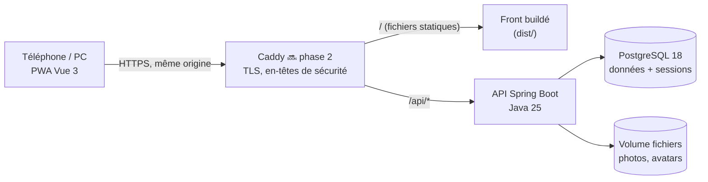
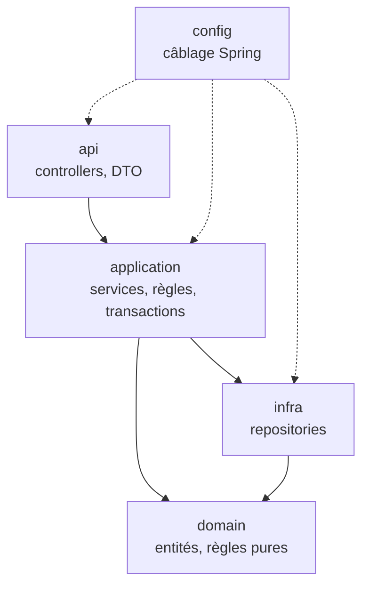
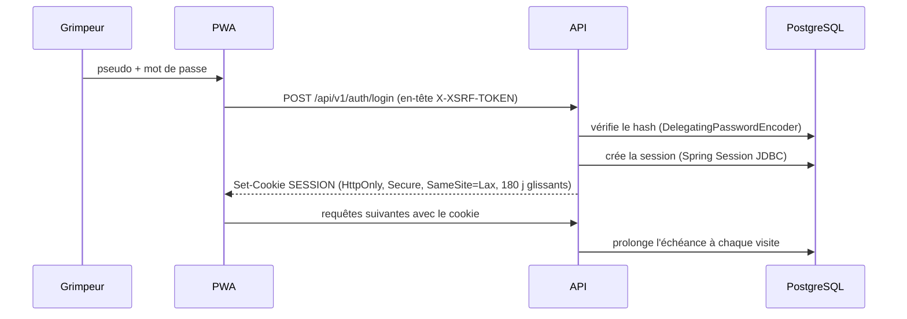

# Architecture

Vue d'ensemble technique de GG Pocket, pour un développeur qui découvre le projet.
Les choix et leurs raisons sont dans `DECISIONS.md` ; la spécification produit dans `KICKOFF_PROMPT.md`.

> Légende : ✅ en place · 🔜 prévu (phase indiquée).

## 1. Vue d'ensemble



- **Une seule origine** : le front et l'API sont servis par le même domaine (`/api` proxifié). Pas de CORS, cookie de session
  `SameSite=Lax` suffisant.
- **Sessions serveur** (Spring Session JDBC) : un cookie `HttpOnly` opaque, la session vit en base. Pas de JWT.
- **En local** : `vite` (port 5173) relaie `/api` vers l'API (port 8080), comme Caddy le fera en prod.

## 2. Backend (`backend/`)

### Découpage

Un package par domaine sous `fr.gravelinesgrimp.pocket`, chacun découpé en couches :

| Domaine | Contenu | État |
|---|---|---|
| `platform` | Transverse technique : erreurs (Problem Details), sécurité, horloge, `/api/v1/meta`, marqueur d'environnement | ✅ |
| `auth` | Connexion, sessions et appareils, inscription, codes d'inscription, code de premier démarrage, réinitialisation, limitation de débit, politique de mot de passe, configuration de Spring Security | ✅ |
| `member` | Membre (`Member`, table `member`), rôles, profil, photos (`MediaFile`, nettoyage des images, volume de fichiers) | ✅ (annuaire en phase 5) |
| `admin` | Gestion des membres (matrice des rôles), journal d'audit, gestion des codes d'inscription | ✅ |
| `club` | Configuration du topo : secteurs, cordes, couleurs de prises, cotations (nom et logos en phase 8) | ✅ |
| `topo` | Voies (ouvreurs, styles, photo, statuts), commentaires, coups de cœur, « je sais la faire », dernière chance, voie préférée | ✅ |
| `session` | Séances, ascensions, planning | 🔜 phase 4 |
| `social` | Amitiés, fil, réactions, commentaires de séance | 🔜 phase 5 |
| `ranking` | Classements mensuels, clôture | 🔜 phase 6 |
| `badge` | Moteur de badges | 🔜 phase 7 |



Règles vérifiées par `ArchitectureTest` (ArchUnit) : sens des dépendances ci-dessus, `domain` sans dépendance web ni
servlet, controllers dans `api`, repositories dans `infra`, **aucune entité JPA dans une signature ou un DTO de `api`**.

### Conventions transverses

- **API** versionnée sous `/api/v1`, documentée par springdoc (`/v3/api-docs`, désactivé en prod). Le contrat est commité
  dans `frontend/src/api/openapi.json` et vérifié par `OpenApiContractIT`.
- **Erreurs** : `application/problem+json` (RFC 9457) avec `code` (énumération `ErrorCode`, stable) et `errors` (champs
  invalides). Les 401/403 de la chaîne de sécurité passent par le même gestionnaire (`ProblemDetailsSecurityErrorHandler`).
  Les règles métier lèvent `BusinessException(code)` ; l'API traduit la catégorie du code en statut HTTP.
- **Sécurité** (`auth/config/SecurityConfig`) : tout est fermé par défaut ; liste blanche : `GET /api/v1/meta`,
  `GET /api/v1/auth/state`, les `POST` de connexion, déconnexion, inscription et réinitialisation, `GET /actuator/health`,
  `GET /v3/api-docs`. CSRF en mode SPA (jeton dans le cookie `XSRF-TOKEN`, renvoyé dans l'en-tête `X-XSRF-TOKEN`).
  Rôles hiérarchiques (`ROLE_ADMIN > ROLE_BOARD > ROLE_SETTER > ROLE_CLIMBER`) ; chaque service de gestion porte son
  `@PreAuthorize`, et la matrice « qui gère qui » est une règle pure (`admin/domain/MemberGovernance`). Aucun utilisateur
  ni mot de passe par défaut.
- **Dépendances entre domaines** : `member` ne dépend de personne ; `auth` dépend de `member` ; `admin` de `auth` et `member` ;
  `club` de `member` et `admin` (journal d'audit) ; `topo` de `club`, `member` et `admin`. `member` ne porte que l'identifiant
  de la voie préférée (`member.favorite_route_id`), sans association : c'est `topo` qui la choisit et la vérifie.
- **Temps** : horodatages en UTC (`timestamptz`, `Instant`) ; règles calendaires en `Europe/Paris` (semaines ISO, mois).
  « Maintenant » vient toujours du bean `Clock`, pour que les tests fixent l'heure.
- **Configuration** : préfixe `gg` (`GgProperties`), alimenté par variables d'environnement (`GG_ENVIRONMENT`, …).
- **Marqueur d'environnement** : la table `instance_marker` retient l'environnement de la base au premier démarrage ;
  `InstanceMarkerGuard` refuse de démarrer contre une base d'un autre environnement.
- **Version** : le fichier `VERSION` est copié dans le jar et exposé par `/api/v1/meta`.

### Tests

| Type | Outil | Nommage | Lancement |
|---|---|---|---|
| Unitaires | JUnit 6, AssertJ, Mockito | `*Test` | `./mvnw test` |
| Tranche web | `@WebMvcTest` | `*Test` | `./mvnw test` |
| Intégration | `@IntegrationTest` (contexte complet, PostgreSQL Testcontainers, MockMvc + vraie chaîne de sécurité) | `*IT` | `./mvnw verify` |
| Architecture | ArchUnit | `ArchitectureTest` | `./mvnw test` |

Tous les tests d'intégration portent exactement `@IntegrationTest` pour partager un seul contexte Spring et un seul conteneur.

## 3. Frontend (`frontend/`)

```
src/
├── api/          client typé (openapi-fetch), erreurs, requêtes TanStack Query, contrat + types générés
├── assets/       logos du club
├── components/
│   ├── ui/       design system : RouteLabel, HoldSwatch, GgButton, SegmentedControl…
│   ├── icons/    icônes dessinées pour l'appli
│   └── layout/   app shell : header, barre d'onglets, bouton « Nouvelle séance », bandeau DEV
├── i18n/         fr.json (tous les textes, par écran) + configuration vue-i18n typée
├── lib/          fonctions pures et testées (installation, âge, formulaires, dates, tri des membres, photos…)
├── router/       routes, titres de page
├── stores/       Pinia : état d'interface uniquement (thème…)
├── styles/       tokens.css (palette par thème) + main.css (Tailwind v4, typographie)
└── views/        un écran par route (+ views/dev/ : galerie, dev uniquement)
```

- **État serveur** : TanStack Query (cache, invalidations, nouvelles tentatives seulement si utile). **État d'interface** : Pinia.
- **Textes** : vue-i18n, messages précompilés au build (pas de compilateur à l'exécution, donc pas d'`eval` : compatible CSP stricte).
  Clés typées : une faute de frappe dans `t('…')` casse le typecheck.
- **Thème** : `auto` (CSS `prefers-color-scheme`), ou clair/sombre forcé via `data-theme` sur `<html>`, appliqué avant le premier
  affichage par `public/theme-init.js`.
- **Routes** : onglets Actu (chargé d'emblée), Topo, À faire, Planning, Podium ; profil via l'avatar ; le reste en chargement différé.
  `meta.public` (accessible sans compte), `meta.layout: 'bare'` (sans en-tête ni onglets), `meta.minRole` (gestion).
- **PWA** : vite-plugin-pwa en mode `prompt` (bandeau « Une nouvelle version est arrivée »), seul l'app shell est mis en cache,
  jamais les réponses de l'API. Invitation à installer selon le navigateur (`lib/install.ts`, `stores/install.ts`).
- **E2E** : Playwright contre le build, l'API étant simulée avec état par `e2e/fakeClub.ts` (membres, codes, sessions par cookie,
  contrôle CSRF, horloge avancée par les tests).

## 4. Authentification



- **Session** : nouvelle à chaque connexion ; 180 jours d'inactivité glissants avec « Rester connecté » (cookie renvoyé tous les
  7 jours pour glisser aussi côté navigateur), 12 heures sinon (DECISIONS D-048). La session ne contient que l'identifiant du
  membre : `CurrentMemberFilter` relit rôle et statut à chaque requête.
- **Mes appareils** : les sessions d'un membre sont retrouvées par leur `PRINCIPAL_NAME` (l'identifiant du membre) ; chacune porte
  un identifiant public aléatoire, jamais l'identifiant de session.
- **Inscription** : code du club vérifié (limité en débit), formulaire, connexion immédiate. **Réinitialisation** : lien créé par la
  direction (jeton haché, 24 h, usage unique, dans le fragment de l'URL), toutes les sessions fermées après usage.
- **Front** : `GET /api/v1/auth/state` au démarrage (pose aussi le cookie CSRF) ; la garde du routeur envoie les visiteurs sur
  `/accueil` ; un 401 n'importe où fait revenir à la connexion avec une explication ; sans réseau, jamais de déconnexion.

Conçu pour accueillir les passkeys (WebAuthn) plus tard sans refonte : l'identité (`Member`) est séparée des moyens de connexion.

## 5. Modèle de données cible

Base de travail issue de la spec (§7), affinée phase par phase. Identifiants UUID, `created_at` / `updated_at` partout.


Tables en place : `instance_marker` (V1), `member` et `media_file` (V2), `spring_session` et `spring_session_attributes` (V3),
`registration_code` et `password_reset_token` (V4), `audit_entry` (V5), `demo_seed_entry` (V6), `sector`, `cord`, `hold_color` et
`grade` avec la configuration réelle du club, identique en dev et en prod (V7), `route`, `route_setter`, `route_style`,
`route_comment`, `favorite`, `route_check` et `last_chance_ack` (V8). Les autres arrivent avec leur phase.

Le topo (`GET /api/v1/routes`) renvoie toutes les voies au mur avec leurs compteurs en quelques requêtes groupées ; le
navigateur trie, filtre et regroupe (D-078). Une voie démontée est en lecture seule ; rien ne se supprime dans la
configuration (on désactive une corde ou une couleur) pour que l'historique reste juste.

## 6. Exploitation

Deux images (`gg-pocket-api`, `gg-pocket-web`), un projet Docker Compose par environnement (`deploy/compose.yml` + surcharge),
un proxy frontal Caddy partagé (`deploy/edge/`), des scripts de déploiement, retour arrière, sauvegarde et restauration
(`deploy/scripts/`). Schéma, choix et limites : `docs/DEPLOYMENT.md` et `DECISIONS.md` D-059 à D-070.
