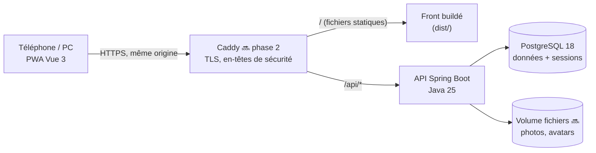
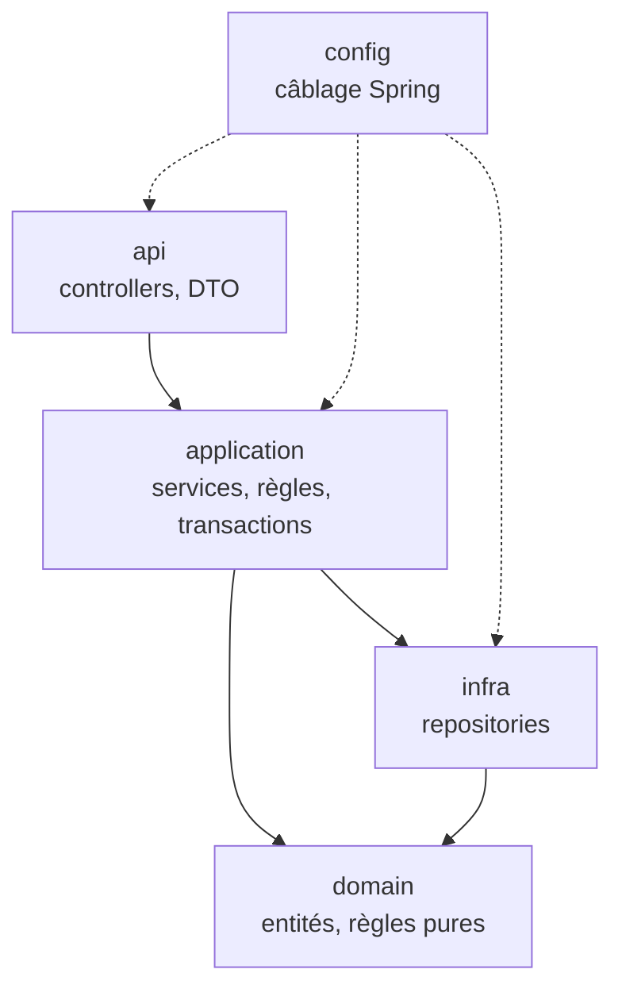
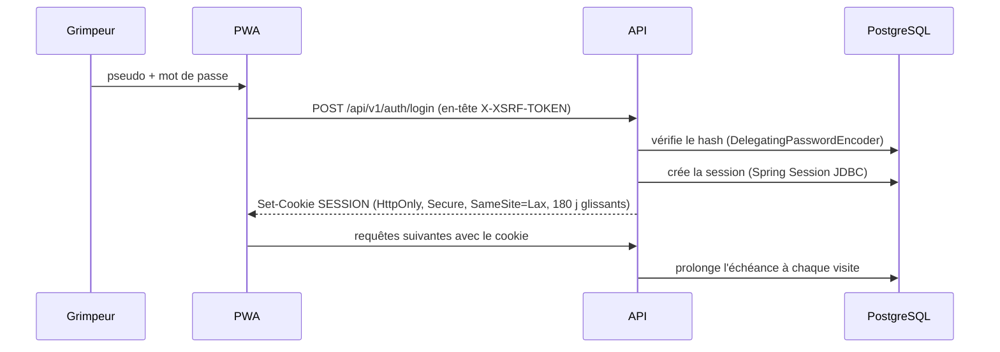
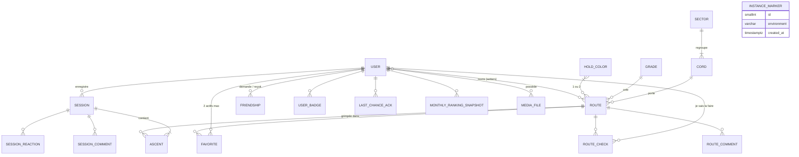

# Architecture

Vue d'ensemble technique de GG Pocket, pour un développeur qui découvre le projet.
Les choix et leurs raisons sont dans `DECISIONS.md` ; la spécification produit dans `KICKOFF_PROMPT.md`.

> Légende : ✅ en place · 🔜 prévu (phase indiquée).

## 1. Vue d'ensemble



- **Une seule origine** : le front et l'API sont servis par le même domaine (`/api` proxifié). Pas de CORS, cookie de session
  `SameSite=Lax` suffisant.
- **Sessions serveur** (Spring Session JDBC, 🔜 phase 1) : un cookie `HttpOnly` opaque, la session vit en base. Pas de JWT.
- **En local** : `vite` (port 5173) relaie `/api` vers l'API (port 8080), comme Caddy le fera en prod.

## 2. Backend (`backend/`)

### Découpage

Un package par domaine sous `fr.gravelinesgrimp.pocket`, chacun découpé en couches :

| Domaine | Contenu | État |
|---|---|---|
| `platform` | Transverse technique : erreurs (Problem Details), sécurité, horloge, `/api/v1/meta`, marqueur d'environnement | ✅ |
| `auth` | Inscription, connexion, sessions, codes d'inscription, réinitialisation | 🔜 phase 1 |
| `member` | Profils, rôles, annuaire, consentements | 🔜 phase 1 |
| `admin` | Journal d'audit, gestion des membres | 🔜 phase 1 |
| `club` | Configuration : nom, logos, secteurs, cordes, couleurs, cotations | 🔜 phase 3 |
| `topo` | Voies, commentaires, coups de cœur, « je sais la faire », dernière chance | 🔜 phase 3 |
| `session` | Séances, ascensions, planning | 🔜 phase 4 |
| `social` | Amitiés, fil, réactions, commentaires de séance | 🔜 phase 5 |
| `ranking` | Classements mensuels, clôture | 🔜 phase 6 |
| `badge` | Moteur de badges | 🔜 phase 7 |



Règles vérifiées par `ArchitectureTest` (ArchUnit) : sens des dépendances ci-dessus, `domain` sans dépendance web ni
servlet, controllers dans `api`, repositories dans `infra`, **aucune entité JPA dans une signature ou un DTO de `api`**.

### Conventions transverses

- **API** versionnée sous `/api/v1`, documentée par springdoc (`/v3/api-docs`, désactivé en prod). Le contrat est commité
  dans `frontend/src/api/openapi.json` et vérifié par `OpenApiContractIT`.
- **Erreurs** : `application/problem+json` (RFC 9457) avec `code` (énumération `ErrorCode`, stable) et `errors` (champs
  invalides). Les 401/403 de la chaîne de sécurité passent par le même gestionnaire (`ProblemDetailsSecurityErrorHandler`).
  Les règles métier lèvent `BusinessException(code)` ; l'API traduit la catégorie du code en statut HTTP.
- **Sécurité** : tout est fermé par défaut ; liste blanche : `GET /api/v1/meta`, `GET /actuator/health`, `GET /v3/api-docs`.
  CSRF en mode SPA (jeton dans un cookie lisible, renvoyé en en-tête). Aucun utilisateur par défaut.
- **Temps** : horodatages en UTC (`timestamptz`, `Instant`) ; règles calendaires en `Europe/Paris` (semaines ISO, mois).
  « Maintenant » vient toujours du bean `Clock`, pour que les tests fixent l'heure.
- **Configuration** : préfixe `gg` (`GgProperties`), alimenté par variables d'environnement (`GG_ENVIRONMENT`, …).
- **Marqueur d'environnement** : la table `instance_marker` retient l'environnement de la base au premier démarrage ;
  `InstanceMarkerGuard` refuse de démarrer contre une base d'un autre environnement.
- **Version** : le fichier `VERSION` est copié dans le jar et exposé par `/api/v1/meta`.

### Tests

| Type | Outil | Nommage | Lancement |
|---|---|---|---|
| Unitaires | JUnit 6, AssertJ, Mockito | `*Test` | `./mvnw test` |
| Tranche web | `@WebMvcTest` | `*Test` | `./mvnw test` |
| Intégration | `@IntegrationTest` (contexte complet, PostgreSQL Testcontainers, MockMvc + vraie chaîne de sécurité) | `*IT` | `./mvnw verify` |
| Architecture | ArchUnit | `ArchitectureTest` | `./mvnw test` |

Tous les tests d'intégration portent exactement `@IntegrationTest` pour partager un seul contexte Spring et un seul conteneur.

## 3. Frontend (`frontend/`)

```
src/
├── api/          client typé (openapi-fetch), erreurs, requêtes TanStack Query, contrat + types générés
├── assets/       logos du club
├── components/
│   ├── ui/       design system : RouteLabel, HoldSwatch, GgButton, SegmentedControl…
│   ├── icons/    icônes dessinées pour l'appli
│   └── layout/   app shell : header, barre d'onglets, bouton « Nouvelle séance », bandeau DEV
├── i18n/         fr.json (tous les textes, par écran) + configuration vue-i18n typée
├── lib/          fonctions pures (couleurs, avatars, types métier côté client)
├── router/       routes, titres de page
├── stores/       Pinia : état d'interface uniquement (thème…)
├── styles/       tokens.css (palette par thème) + main.css (Tailwind v4, typographie)
└── views/        un écran par route (+ views/dev/ : galerie, dev uniquement)
```

- **État serveur** : TanStack Query (cache, invalidations, nouvelles tentatives seulement si utile). **État d'interface** : Pinia.
- **Textes** : vue-i18n, messages précompilés au build (pas de compilateur à l'exécution, donc pas d'`eval` : compatible CSP stricte).
  Clés typées : une faute de frappe dans `t('…')` casse le typecheck.
- **Thème** : `auto` (CSS `prefers-color-scheme`), ou clair/sombre forcé via `data-theme` sur `<html>`, appliqué avant le premier
  affichage par `public/theme-init.js`.
- **Routes** : onglets Actu (chargé d'emblée), Topo, À faire, Planning, Podium ; profil via l'avatar ; le reste en chargement différé.

## 4. Authentification (🔜 phase 1)



Conçu pour accueillir les passkeys (WebAuthn) plus tard sans refonte : l'identité (`User`) est séparée des moyens de connexion.

## 5. Modèle de données cible

Base de travail issue de la spec (§7), affinée phase par phase. Identifiants UUID, `created_at` / `updated_at` partout.



Tables en place : `instance_marker` (V1). Les autres arrivent avec leur phase.
